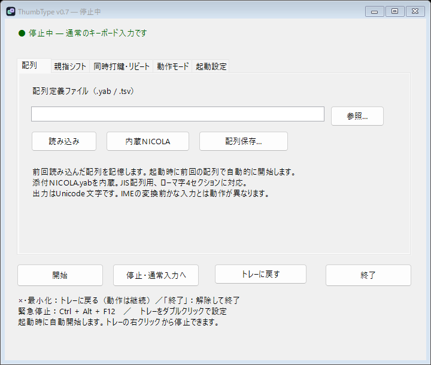
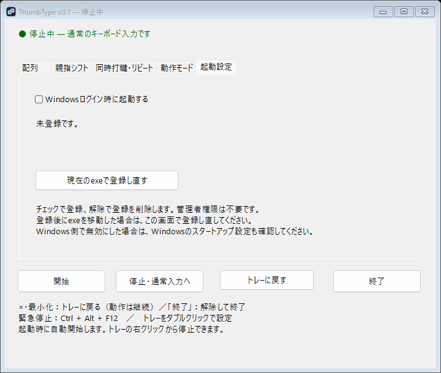

# ThumbType v0.7

親指シフト・キー配列変更用のWindowsポータブルアプリです。
実行ファイルは **ThumbType.exe** です。

[exeをダウンロード](https://github.com/cozy51/ThumbType/raw/refs/heads/main/ThumbType.exe) · [ソース一式をダウンロード](https://github.com/cozy51/ThumbType/archive/refs/heads/main.zip)

ソース一式のzipにはexeを含みません。exeのダウンロードがブロックされる場合は、zipを展開して[自分でビルド](#ソースと再ビルド)してください。



## 更新時の操作

1. 旧アプリを通知領域の「終了」から終了してください。×は終了ではありません。
2. ThumbType.exeを実行します。通知領域に常駐し、起動時に自動開始します。
3. アイコンをダブルクリックして設定を開き、「停止・通常入力へ」を押します。
4. 「配列」の **内蔵NICOLA** を押すか、「参照…」で同梱の `layouts/NICOLA.yab` を選びます。
5. 「開始」を押して、IMEを「あ」にしたメモ帳で確認してください。

**以前のsample-layout.tsvを記憶している場合は、4の操作が必要です。** 古い外部配列の内容は自動で書き換えません。

以前の配列設定を引き継ぐには、旧exeと同じフォルダにThumbType.exeを置いてください。設定ファイル名 `ThumbShiftPortable.settings.xml` は旧版との互換性のため維持しています。旧exeと新exeを両方起動することはできません。

## Windows Defenderに「トロイの木馬」と表示された場合

ThumbTypeは親指シフトを実現するため、キーボード入力をフックして別の文字を送信し、スタートアップに登録できます。
これらはマルウェアと同じ種類のWindows機能なので、**署名のない新しいexe**はDefenderに誤検知されることがあります。
ThumbTypeはネットワーク通信を行わず、ソースは `source/` で公開しています。

1. ダウンロードしたexeが本物か確認します（PowerShell）。結果が `SHA256SUMS.txt` の値と一致すれば、このリポジトリのexeです。
   ```powershell
   Get-FileHash .\ThumbType.exe -Algorithm SHA256
   ```
2. Windowsセキュリティ →「保護の履歴」→ 該当項目 →「操作」→「許可」（隔離済みなら「復元」）を選びます。
3. 誤検知の報告は [Microsoftの提出フォーム](https://www.microsoft.com/wdsi/filesubmission) から「Incorrectly detected as malware」で送れます。承認されると他のPCでも検出されなくなります。

許可はそのexe（同じハッシュ）に対して有効です。新しい版に更新すると再度検出されることがあります。

exeやzipのダウンロード自体がブロックされる場合は、ソース一式のzip（exeを含みません）を展開して、手元でビルドしてください。手順は「ソースと再ビルド」にあります。手元でビルドしたexeは、ダウンロードしたファイルより検出されにくくなります（必ず検出されないとは限りません）。

## 同梱NICOLA.yabの反映

以前の29キーの学習用サンプルを、同梱のNICOLA.yabに基づく **JIS 109キーボード用・48キー・4層** の配列へ置き換えました。

| 操作（初期設定） | 出力例 |
| --- | --- |
| J | と |
| 右Shift＋J | お |
| ;（セミコロン） | ん |
| Space＋; | よ |
| 右Shift＋; | っ |
| Space＋Z | ぅ |
| 右Shift＋/ | ぉ |
| Space＋X | ー |
| Space＋/ | ゛ |
| 右Shift＋Q | ゜ |
| 左Shift＋1 | ！ |
| 左Shift＋J | Ｊ（全角） |
| :（コロン） | Backspace |
| ] | Escape |

数字・記号・小書きかな・濁音・半濁音の割り当ても取り込みました。全定義は `layouts/NICOLA.tsv` で確認できます。

右Shiftは初期設定で右親指キーなので、小指シフトには左Shiftを使います。親指に指定していないShiftが小指シフトになります。小指シフトと親指が重なった場合は小指シフトを優先します。小指シフトの定義がない従来の4列TSVでは、そのShiftを通常入力として通します。

## .yabと.tsv

「参照…」で、お手元の同形式の `NICOLA.yab` も直接指定できます。

対応する.yabは、同梱ファイルにある次の4セクションを、それぞれ4行のJIS物理キー配列で記述した形式です。

- ローマ字シフト無し
- ローマ字左親指シフト
- ローマ字右親指シフト
- ローマ字小指シフト

UTF-8、BOM付きUTF-16、UTF-8として読めない場合のShift-JISを読み込みます。同梱のNICOLA.yabはUTF-16LEです。未対応セクション・未対応のローマ字列・不正な行数／列数はエラーにします。**やまぶきRの全機能・すべての.yab/.yprに対応するものではありません。**

.yabの全角ローマ字はかなへ変換し、引用符で囲まれた文字はリテラルとして扱います。引用符のない「．」「，」「／」「－」「［」「］」は日本語の句読点等（。・、・中点・長音・かぎ括弧）へ変換しています。引用符付きの「．」と引用符なしの「．」は異なる出力になります。元のIMEの句読点設定や変換動作まで再現するものではありません。

「無」は明示的な出力なし、「後」はBackspace、「逃」はEscapeです。出力なしの層が通常文字へ戻ってしまわないようにしました。

TSVはUTF-8のタブ区切りで、4列または5列です。

`キー名 / 通常 / 左親指 / 右親指 / 小指Shift（省略可）`

キー名はWindows FormsのKeys名です。予約出力 `{None}`、`{Backspace}`、`{Escape}` を指定できます。空のシフト列は通常列へ戻りますが、`{None}` は出力を抑止します。同梱TSVは.yabと同じ定義を変換したものです。

## 使い方と常駐

- 初期値は左Space・右Shift、同時打鍵65ms、左右の連続シフト有効です。
- 文字→親指、親指→文字のどちらも時間範囲内で認識します。
- 文字キーを先に離すと通常文字が確定し、その後の親指は遡って適用しません。
- 未使用の親指は離した時に元のキーを1回送ります。単独打鍵は無効にできます。
- IMEの英数「A」・IMEオフ・状態取得失敗では通常入力を通します。
- IMEの日本語入力モードでだけ配列変換します。
- 起動時に自動開始し、復元失敗・緊急停止ホットキー登録失敗・フック開始失敗では停止します。
- トレーのダブルクリックで設定、右クリックで開始・停止・終了を操作します。
- ×・最小化・「トレーに戻す」は画面を隠すだけで、動作は継続します。
- 完全終了は「終了」。緊急停止は **Ctrl＋Alt＋F12** です。
- 停止後・セッション切替後・スリープ後は手動で再開してください。
- 配列ファイルの場所は読み込み成功時に保存します。その他の設定は保存しません。

## 安全設計と制限

レジストリ、Windows配列、IME設定、ドライバを変更しません。インストーラ、管理者権限、サービス、ネットワーク通信は不要です。スタートアップ登録は任意で行えます。Windowsの.NET Framework 4.xが必要です。実行ファイルは未署名です。

文字はUnicodeで直接出力します。IMEの未確定文字や文節変換を再現するものではありません。濁点・半濁点の単独出力も文字そのものであり、自動的に直前のかなを濁音化する機能ではありません。USキーボードのOEM記号キー位置はJISと異なるため、添付配列はJIS用として使用してください。

Ctrl・Alt・Windowsキーのショートカット、管理者権限の対象、本アプリ内では配列変更を避けます。モードやウィンドウの切り替えでは未確定入力を破棄します。正常終了・検出した例外・送信失敗で解除します。強制終了したプロセスは以後の入力を処理しません。Windows自体や他の常駐ソフトの障害を復旧するものではありません。

実キーボード、各IME、アプリごとの動作は受入確認が必要です。メモ帳の保存不要な文書で確認してください。IME状態を取得できないアプリでは通常入力へ戻ります。Windowsにフックをタイムアウト解除されると、表示が動作中でも通常入力になる場合があります。

## ソースと再ビルド

ソース一式のzipを展開したフォルダで、`source/build.ps1` をWindows PowerShellから実行します。フォルダ直下に `ThumbType.exe` ができます。追加パッケージは不要です。アイコンはexeに内蔵されています。同梱NICOLA.yabも内蔵するのでexe単体で実行できます。

```powershell
powershell -NoProfile -ExecutionPolicy Bypass -File .\source\build.ps1
```

元配列は `layouts/NICOLA.yab`、変換済み配列は `layouts/NICOLA.tsv` です。元配列を変更して内蔵する場合は再ビルドしてください。

自動検証は `ThumbType.exe --self-test`、設定復元は `--settings-test`、トレー動作は `--tray-test`、起動予約は `--startup-test` で実行できます。実入力を送らない検証です。

参考: [Microsoft IME Conversion Mode Values](https://learn.microsoft.com/en-us/windows/win32/intl/ime-conversion-mode-values)、[SendInput](https://learn.microsoft.com/en-us/windows/win32/api/winuser/nf-winuser-sendinput)。

## v0.7：Windowsログイン時の起動

設定画面の「起動設定」で「Windowsログイン時に起動する」にチェックすると登録し、チェックを外すと解除します。設定画面を開くだけでは登録しません。初期状態では登録しません。

現在のユーザーのスタートアップフォルダに `ThumbType.lnk` を作成する方式です。管理者権限は不要で、レジストリは変更しません。登録先は画面に表示します。Windowsへログインするとトレーに常駐し、従来どおり配列の復元・自動開始を行います。動作中でもこの設定だけは変更できます。

最初にexeを普段使うフォルダへ置いてから登録してください。exeを移動した場合は、新しいexeの「起動設定」で「現在のexeで登録し直す」を押します。アプリの終了やexeの削除では登録を自動削除しないため、使わなくなる場合は先にチェックを外してください。

Windowsの設定やタスクマネージャー側でスタートアップを無効化した場合、この画面ではショートカットの登録有無のみを表示します。起動しない場合はWindows側のスタートアップ設定も確認してください。組織のポリシー等によって自動起動が制限されることがあります。

同名の既存ショートカットがThumbTypeの作成したものではない場合、上書き・削除しません。エラーは画面に表示し、登録状態を読み直します。

参考：[Microsoftのスタートアップアプリ設定](https://support.microsoft.com/en-gb/windows/experience/startup-boot/configure-startup-applications-in-windows)

検証用の `ThumbType.exe --registration-test` はexe隣の一時テストフォルダだけでショートカットの登録・解除を確認し、実際のスタートアップには書き込みません。

## 検証結果

入力処理250項目、配列設定10項目、起動予約6項目、トレー11項目、スタートアップ登録12項目を自動検証しています。実際のIME・物理キーボード・Windows再ログインでの検証範囲は [検証記録](docs/validation.txt) を参照してください。


